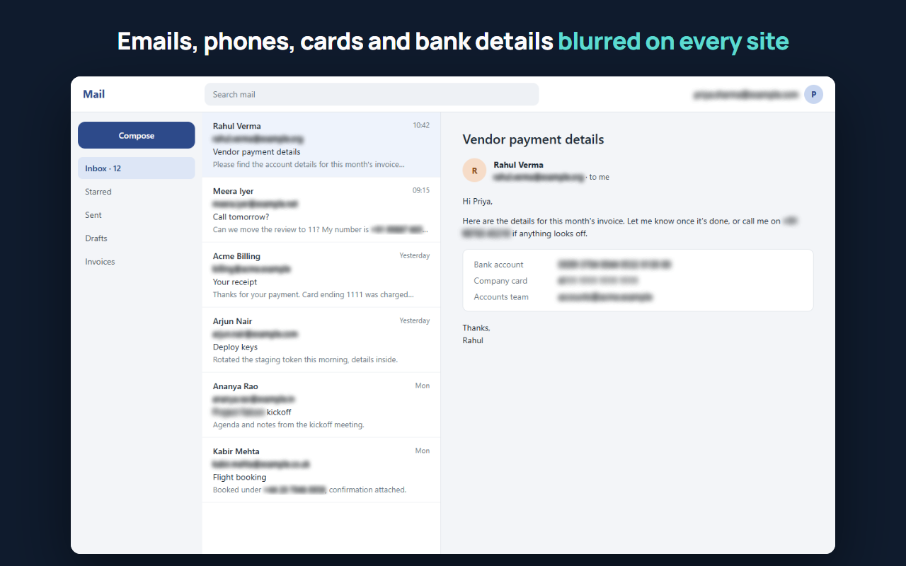
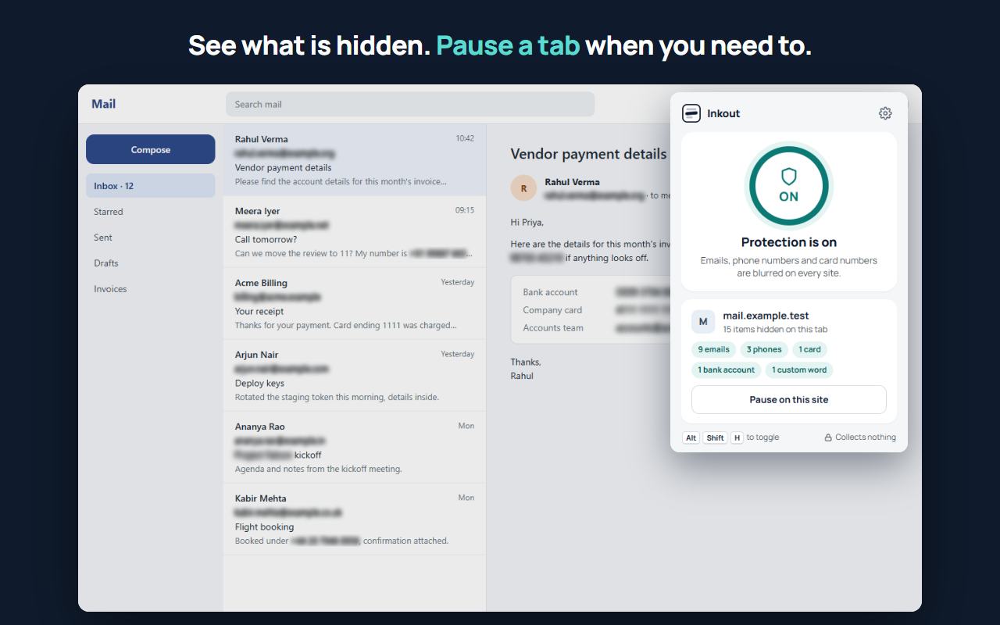
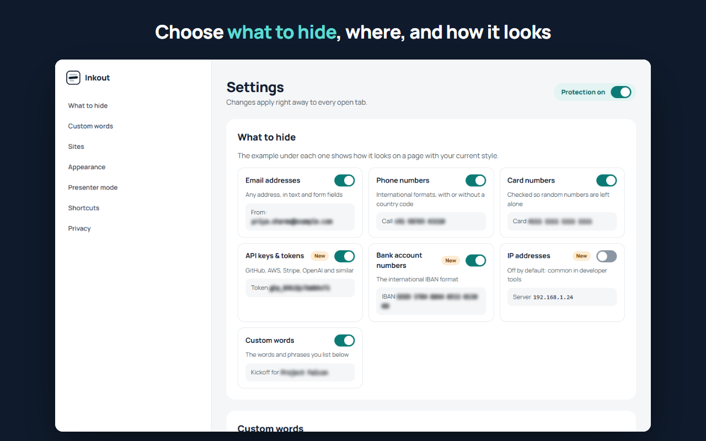

# Inkout

**Share your screen, not your inbox.** Inkout is a free Chrome extension that blurs email addresses, phone numbers, card numbers, API keys and other sensitive text on every web page, so the people on your video call never see them.

[Website](https://kunalkumarkkr01.github.io/inkout/) · [Privacy policy](https://kunalkumarkkr01.github.io/inkout/privacy.html) · Chrome Web Store: coming soon



| See what's hidden on each tab | Choose what to hide |
|---|---|
|  |  |

It works on any site, including apps like web mail that keep loading new content. It doesn't change the page's structure: it paints over the matching text using the CSS Custom Highlight API, so sites keep working normally.

## Features

What it hides, each with its own switch:

| Type | Examples |
|------|----------|
| Email addresses | `priya.sharma@example.com`, `a+tag@mail.co.uk`, `josé@exämple.com` |
| Phone numbers (10–15 digits) | `+91 98765 43210`, `(555) 123-4567`, `+44 20 7946 0958`, `01.23.45.67.89` |
| Card numbers (13–19 digits, Luhn-checked) | `4111 1111 1111 1111`, `3782 822463 10005` |
| API keys and tokens | GitHub `ghp_…`, AWS `AKIA…`, Stripe `sk_live_…`, Slack `xoxb-…`, Google `AIza…`, OpenAI-style `sk-…`, JWTs |
| Bank account numbers (IBAN, check digits verified) | `DE89 3704 0044 0532 0130 00`, `GB82 WEST 1234 5698 7654 32` |
| IP addresses (off by default) | `192.168.1.24` |
| Your own words and phrases | `Project Falcon`, client names; regular expressions as an advanced option |

Dates, times, versions and prices are not mistaken for phone numbers.

- **Blur or solid bar**, with light, medium or strong blur.
- **Everywhere on the page:** text fields (whether you typed the value or the page filled it in), tab titles, same-site, cross-site and blank frames, web components (open and closed shadow roots), and SVG text.
- **Selecting hidden text keeps it hidden.**
- **Presenter mode:** notices when a tab starts sharing your screen in Meet, Teams, Zoom and other meeting sites on the web, and turns protection on if it was off. It can also turn it back off when the share ends.
- **Blur the whole page** with **Alt+Shift+K**, for surprises. Press again to undo.
- **Pause on this site** from the toolbar popup: only that tab, until you resume, close the tab or move to another site. The icon shows an amber **❚❚** badge while paused.
- **Site rules:** run on every site (default) or only on sites you choose, plus a "Never hide on" list.
- **Alt+Shift+H** turns protection on or off. A red **OFF** badge shows when it's off, so you can check before you share. Change shortcuts at `chrome://extensions/shortcuts`.
- **Dark mode** for the popup, settings and welcome pages.

## Privacy

Everything runs on your device. Inkout collects nothing, sends nothing anywhere and makes no network requests. There's no account, no analytics and no remote code. Settings are saved with Chrome's own sync storage. Read the [privacy policy](https://kunalkumarkkr01.github.io/inkout/privacy.html).

## Install

Until it's on the Chrome Web Store, load it from this repository:

1. Download or clone this repository.
2. Open `chrome://extensions` in Chrome.
3. Turn on **Developer mode** (top right).
4. Click **Load unpacked** and select the repository folder.
5. Reload any tabs that were already open.

## Limitations

- Only the web page's content is hidden. Chrome's own interface is not: the address bar, bookmarks and autofill dropdowns.
- A value split across elements is missed, for example `john` in one tag and `@example.com` in the next.
- Text drawn as images, on a canvas, or in Chrome's PDF viewer can't be read, so it isn't hidden.
- Presenter mode only sees shares started from a web page. Shares started from desktop apps (installed Zoom or Teams) can't be detected.
- Phone numbers shorter than 10 digits without a country code (such as an 8-digit local number) are not detected.
- Chrome doesn't run extensions on `chrome://` pages or the Chrome Web Store.
- Some long numbers, such as 10-digit order IDs, get blurred as phone numbers. This is intentional: hiding too much is safer than hiding too little.
- To catch values set by page scripts, components created later and screen shares, `src/page-hooks.js` wraps the `value` setter of inputs and text areas, `Element.attachShadow`, `getDisplayMedia` and `MediaStreamTrack.stop` in the page's own JavaScript world. A small number of anti-tampering scripts (some banking sites) check whether built-in functions were changed.

## Development

```bash
npm test
```

This runs every test with Node's built-in test runner (Node 22+, no dependencies):

- **Unit tests** (`tests/*.test.js`): detection across international formats, lookalikes that must not match, hostile input that must not freeze a page, settings, site rules, per-tab state, presenter mode, the manifest and the store images.
- **Browser tests** (`tests/browser/`): load the real extension into headless Chrome with a throwaway profile, open the pages in `tests/browser/fixtures/`, and check what is hidden and what is actually drawn. The fixtures use pure red text, so any red pixel left where a value should be hidden means the original text is showing. They need Chrome installed; set `CHROME_PATH` if it isn't in the default location. Without Chrome they are skipped locally but required on CI.

```bash
npm run render -- icons   # icons/*.png from the logo
npm run render -- store   # store/*.png and site/images/*.png from the real pages
```

### Release

```bash
npm run package
```

This writes `dist/inkout-<version>.zip` (the version comes from `manifest.json`), with `manifest.json` at the root and only `manifest.json`, `src/` and `icons/` inside. Upload that zip in the Chrome Web Store developer dashboard; the listing text and images are in `store/`.

`tests/demo.html` is a manual test page. It loads the content script with an in-memory stand-in for `chrome.storage`. Serve the folder over HTTP (not `file://`) and open `/tests/demo.html`.

| File | Purpose |
|------|---------|
| `manifest.json` | Extension manifest (MV3) |
| `src/detectors.js` | Finds emails, phones, cards, API keys, IBANs, IPs and custom words in text |
| `src/content.js` | Scans the page, watches for changes, applies the blur, hides the tab title |
| `src/content.css` | Hide styles |
| `src/page-hooks.js` | Runs in the page's world; announces script-set values, new shadow roots and screen shares |
| `src/settings.js` | Shared settings: defaults, load, save, change listener |
| `src/sites.js` | Site rules |
| `src/tab-state.js` | Per-tab counts and pauses, and the toolbar badge |
| `src/presenter.js` | Presenter-mode decisions |
| `src/background.js` | Service worker: shortcuts, per-tab state, presenter mode, badge |
| `src/popup.*` | Toolbar popup |
| `src/options.*`, `src/pattern-check.js` | Settings page |
| `src/welcome*` | Welcome page, opened once on install |
| `scripts/render.js` | Renders icons and store images with headless Chrome |
| `store/` | Chrome Web Store images and listing text |
| `site/` | Project website (GitHub Pages) |
| `tests/browser/` | Headless-Chrome test harness, fixtures and end-to-end tests |

## License

[MIT](LICENSE). Free to use, change and share.
